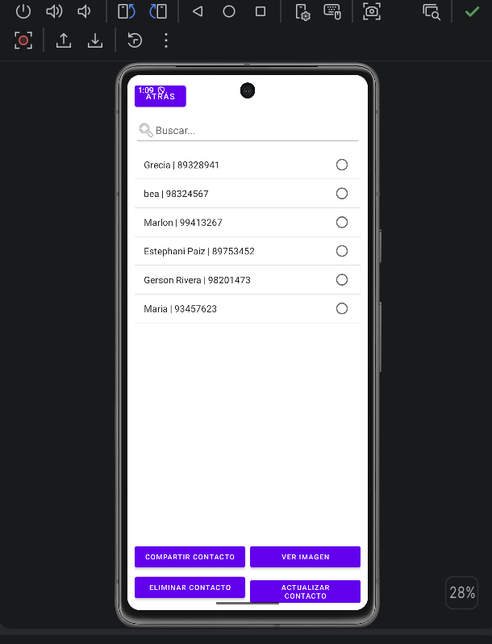
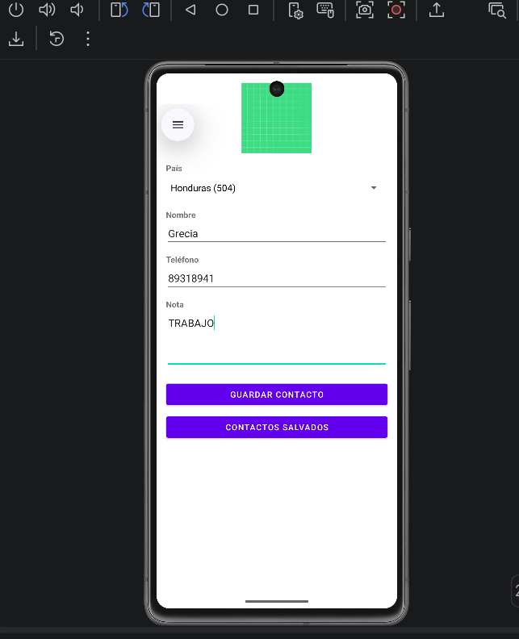
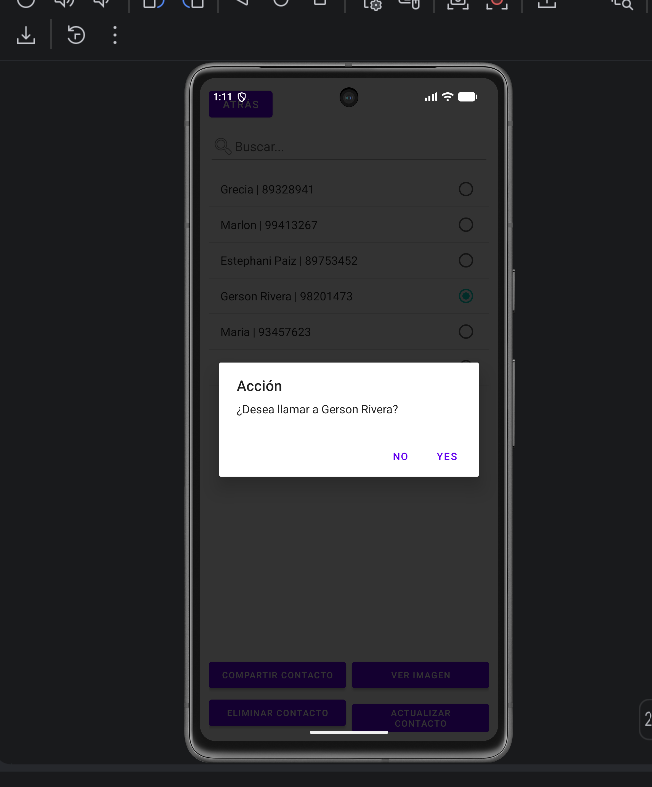

## Examen Primer Parcial - Programación para Dispositivos Móviles I

**Universidad:** UCENM  
**Asignatura:** Programación para Dispositivos Móviles I  
**Catedrático:** ING. Ricardo Enrique Lagos Mendoza

---

## Datos del Estudiante
* **Nombre Completo:** [Grecia Beatriz Vasquez]
* **Número de Cuenta:** [124280002]
* **Repositorio:** PM01E10002

## Descripción del Proyecto
Aplicación móvil desarrollada en Android Studio para la gestión de contactos con persistencia local en SQLite.

### Funcionalidades Implementadas:
1. **Pantalla 1 - Registro de Contactos:**
    - Captura de foto mediante la cámara.
    - Selección de país con código de área (Spinner).
    - Validaciones de campos vacíos mediante `AlertDialog`.
    - Validación de formato con expresiones regulares (solo letras para nombre, solo dígitos para teléfono).
    - Guardado y actualización en SQLite.

2. **Pantalla 2 - Lista de Contactos:**
    - Visualización de registros desde SQLite en un `ListView`.
    - Buscador dinámico de contactos (Punto extra).
    - Opciones para ver imagen, compartir datos (Intent `ACTION_SEND`), actualizar y eliminar registros.
    - Alerta emergente de confirmación antes de realizar llamadas.

3. **Pantalla 3 - Llamada Telefónica:**
    - Realización de llamadas directas utilizando el Intent `ACTION_CALL`.
    - Gestión de permisos en tiempo de ejecución para `CALL_PHONE`.

